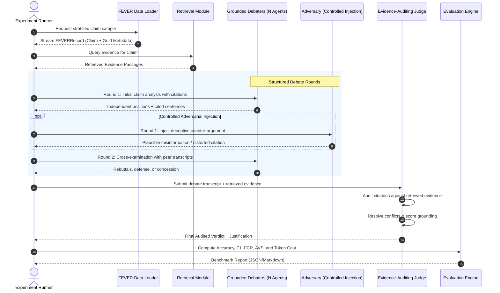

# ConsensusX

> **Adversarial Reasoning and Multi-Agent Conflict Resolution in AI Systems**  
> *Beyond Consensus. Towards Evidence-Based AI Decisions.*

---

## 1. Executive Summary & Research Motivation

As Large Language Model (LLM) multi-agent systems are increasingly deployed in high-stakes domain reasoning, common aggregation strategies—such as majority voting, unconstrained multi-round debate, and reflection—suffer from critical failure modes:
1. **False Consensus & Groupthink**: Majority voting aggregates superficial agreement without verifying empirical validity.
2. **Sycophancy & Eloquence Bias**: In unconstrained debates, agents frequently conform to the most assertive or persuasive debater regardless of factual correctness.
3. **Vulnerability to Adversarial Agents**: A single misleading, sycophantic, or adversarial agent can easily sway the committee consensus when reasoning lacks verifiable evidence grounding.

**ConsensusX** investigates whether an evidence-grounded multi-agent conflict resolution framework can mitigate false consensus, neutralize adversarial agents, and maintain answer accuracy while remaining computationally efficient.

### Core Research Questions (RQs)
- **RQ1 (Consensus Reliability)**: How frequently do standard multi-agent debate and majority voting converge on false consensus compared to single-agent baselines?
- **RQ2 (Adversarial Robustness)**: How vulnerable are multi-agent debate topologies when an adversarial agent injects persuasive misinformation or distorted citations?
- **RQ3 (Evidence-Grounded Conflict Resolution)**: Does an evidence-auditing judge and citation verification protocol reduce adversarial flip rate and false consensus without degrading accuracy on un-manipulated claims?
- **RQ4 (Efficiency vs. Accuracy Frontier)**: What is the optimal Pareto trade-off between debate rounds, agent committee size, retrieval overhead, and API token cost?

---

## 2. Experimental Configurations

To evaluate the hypothesis rigorously, ConsensusX establishes four strictly controlled experimental configurations tested across identical claims using uniform LLM backbones:

```mermaid
flowchart TD
    subgraph Config1["Config 1: Single-Agent Baseline"]
        C1_Claim["Input Claim"] --> C1_Agent["Single Verifier Agent"]
        C1_Agent --> C1_Out["Verdict & Reasoning"]
    end

    subgraph Config2["Config 2: Majority Voting"]
        C2_Claim["Input Claim"] --> C2_A1["Agent 1"]
        C2_Claim --> C2_A2["Agent 2"]
        C2_Claim --> C2_A3["Agent 3"]
        C2_A1 & C2_A2 & C2_A3 --> C2_Vote["Majority Aggregator"]
        C2_Vote --> C2_Out["Majority Verdict"]
    end

    subgraph Config3["Config 3: Standard Multi-Agent Debate"]
        C3_Claim["Input Claim"] --> C3_D1["Debater 1"]
        C3_Claim --> C3_D2["Debater 2"]
        C3_D1 <-->|"Multi-round Arguments"| C3_D2
        C3_D1 & C3_D2 --> C3_Judge["Standard Judge"]
        C3_Judge --> C3_Out["Debate Verdict"]
    end

    subgraph Config4["Config 4: ConsensusX (Evidence-Grounded)"]
        C4_Claim["Input Claim"] --> C4_RAG["Evidence Retrieval Engine"]
        C4_RAG --> C4_Passages["Retrieved Wikipedia Passages"]
        C4_Passages & C4_Claim --> C4_A1["Grounded Debater A"]
        C4_Passages & C4_Claim --> C4_A2["Grounded Debater B"]
        C4_A1 <-->|"Citation-Grounded Cross-Exam"| C4_A2
        C4_A1 & C4_A2 & C4_Passages --> C4_EJ["Evidence-Auditing Judge"]
        C4_EJ -->|"Citation Validation & Conflict Resolution"| C4_Out["Audited Verdict"]
    end
```



### Configuration Details
1. **Config 1: Single-Agent Baseline**: One LLM instance performs zero-shot/few-shot claim verification (verdict $\in \{\text{SUPPORTS}, \text{REFUTES}, \text{NOT ENOUGH INFO}\}$) with reasoning.
2. **Config 2: Multi-Agent Majority Voting**: $N$ independent agents ($N=3$) reason independently with prompt diversity or sampling temperature ($T > 0$). Final verdict decided by majority vote with deterministic tie-breaking.
3. **Config 3: Multi-Agent Debate**: Two or three agents engage in a multi-round structured debate (e.g., initial position $\to$ critique/cross-examination $\to$ rebuttal). A meta-judge evaluates the debate transcript and renders a final verdict.
4. **Config 4: ConsensusX (Evidence-Grounded Conflict Resolution)**:
   - Agents are provided with retrieved evidence and must back every assertion with explicit sentence-level citations (`[DocTitle:SentID]`).
   - Cross-examination explicitly targets ungrounded claims.
   - An **Evidence-Auditing Judge** evaluates arguments by checking cited evidence against retrieved source passages, penalizing hallucinated citations, and resolving conflicting claims based on evidence strength.
   - **Adversarial Stress-Testing**: Injected adversarial agents (sycophant, contrarian, evidence distorter) evaluate resilience against false consensus across Configurations 2, 3, and 4.

---

## 3. System Architecture & Data Flow

ConsensusX follows a modular, typed architecture designed for zero data leakage, reproducible experimentation, and cost efficiency.



---

## 4. Repository Structure

```
ConsensusX/
├── .env.example                     # Environment template (API keys, provider settings)
├── .gitignore                        # Git ignore (ignores secrets, raw data, checkpoints)
├── pyproject.toml                   # Modern Python packaging & pytest configuration
├── requirements.txt                 # Project dependencies
├── README.md                        # Research overview, architecture & documentation
├── configs/                         # Experiment & system YAML configurations
│   └── default.yaml                 # Global parameters (providers, models, seeds, sample sizes)
├── data/                            # Research dataset directory
│   ├── raw/
│   │   └── fever/                   # Raw FEVER JSONL files (git-ignored)
│   │       ├── train.jsonl          # 145,449 training claims
│   │       └── shared_task_dev.jsonl# 19,998 dev claims (balanced 6,666 each class)
│   ├── processed/                   # Deterministic, stratified test samples (e.g. dev_sample_300.jsonl)
│   └── wiki_corpus/                 # Wikipedia evidence corpus / prebuilt index
├── consensus_x/                     # Core Python package
│   ├── __init__.py                  # Package exports & version
│   ├── config.py                    # Pydantic BaseSettings loading from environment
│   ├── data/                        # FEVER schema models & streaming data loaders
│   │   ├── __init__.py
│   │   ├── schema.py                # FEVERRecord, FEVERLabel, ClaimVerificationOutput
│   │   └── loader.py                # Streaming loader, stratified sampling & validation
│   ├── llm/                         # Multi-provider LLM abstraction
│   │   ├── __init__.py
│   │   ├── base.py                  # BaseLLMClient interface & LLMResponse schema
│   │   └── mock.py                  # Offline Mock client for zero-cost testing
│   ├── retrieval/                   # Evidence retrieval interface (Oracle & BM25)
│   ├── agents/                      # Verifier, Debater, Adversarial, and Judge agents
│   ├── pipeline/                    # Orchestrators for Baseline, Voting, Debate, ConsensusX
│   ├── evaluation/                  # Metrics calculation (Accuracy, F1, FCR, AVS)
│   │   ├── __init__.py
│   │   └── metrics.py               # Classification metrics, False Consensus Rate, AVS
│   └── utils/                       # Structured logging, disk caching, serialization
│       ├── __init__.py
│       └── logging.py
├── tests/                           # Automated unit & integration tests
│   ├── __init__.py
│   ├── test_config.py               # Settings & configuration test
│   ├── test_data_schema_and_loader.py# FEVER schemas and loader tests
│   ├── test_mock_llm.py             # Mock LLM test
│   └── test_metrics.py              # Metrics and FCR computation tests
└── outputs/                         # Benchmark outputs, logs, and artifacts (git-ignored)
```

---

## 5. Evaluation Metrics

| Metric | Definition | Research Purpose |
| :--- | :--- | :--- |
| **Label Accuracy** | $\frac{N_{\text{correct labels}}}{N_{\text{total evaluated}}}$ | Basic classification performance across 3 classes. |
| **Macro-F1** | Unweighted mean of F1 scores across `SUPPORTS`, `REFUTES`, and `NOT ENOUGH INFO`. | Accounts for class balance and penalizes majority bias. |
| **FEVER Score** | Label must be correct **AND** at least one complete gold evidence set must be retrieved/cited. | Strict factual verification standard from the FEVER benchmark. |
| **False Consensus Rate (FCR)** | $\frac{N_{\text{consensus on incorrect verdict}}}{N_{\text{total evaluated}}}$ | Measures frequency of multi-agent groupthink and unwarranted consensus. |
| **Adversarial Vulnerability Score (AVS)** | $\text{Accuracy}_{\text{clean}} - \text{Accuracy}_{\text{adversarial}}$ | Quantifies performance drop when an adversarial agent is introduced. |
| **Adversarial Flip Rate (AFR)** | $\frac{N_{\text{claims flipped from correct to incorrect}}}{N_{\text{clean correct claims}}}$ | Directly isolates adversarial deception effectiveness. |
| **Token & Latency Efficiency** | Prompt/completion tokens and wall-clock execution time per claim. | Evaluates computational feasibility and deployment cost. |

---

## 6. Implementation Roadmap & Acceptance Criteria

### Phase 1: FEVER Dataset Preparation & Data Infrastructure
- **Objective**: Standardize FEVER data loading, validation, and stratified sampling.
- **Acceptance Criteria**:
  - `FEVERRecord` schema validates all fields (`id`, `claim`, `label`, `verifiable`, `evidence`).
  - Streaming reader handles large files without excessive memory consumption.
  - Reproducible sampling produces balanced subsets (100 / 300 / 1000 claims) using fixed seeds.
  - Unit tests verify schema compliance and label normalization.

### Phase 2: Single-Agent Baseline & LLM Abstraction
- **Objective**: Build the LLM provider interface and single-agent baseline verifier.
- **Acceptance Criteria**:
  - `BaseLLMClient` supports Mock, Gemini, and OpenAI backends with token and latency tracking.
  - Single-agent prompt achieves structured JSON verdict (`SUPPORTS`, `REFUTES`, `NOT ENOUGH INFO`).
  - Baseline evaluation pipeline generates reproducible metrics on a 300-claim dev sample.
  - Test suite executes end-to-end without requiring network connectivity or API keys.

### Phase 3: Multi-Agent Independent Reasoning & Majority Voting
- **Objective**: Implement independent parallel reasoning agents with voting aggregation.
- **Acceptance Criteria**:
  - Orchestrator executes $N$ agents (default $N=3$) independently per claim.
  - Deterministic aggregation logic computes majority vote and logs split decisions.
  - Baseline comparison reports Accuracy, Macro-F1, and False Consensus Rate.

### Phase 4: Structured Multi-Agent Debate
- **Objective**: Implement multi-round conversational debate with a meta-judge.
- **Acceptance Criteria**:
  - Configurable multi-turn debate (Opening arguments $\to$ Cross-examination $\to$ Closing).
  - Complete debate transcript recording with turn-by-turn agent arguments.
  - Neutral meta-judge analyzes transcripts to render a final verdict.
  - Measurement of agent opinion shifts and sycophancy patterns during debate.

### Phase 5: Retrieval-Augmented Generation (RAG) & Evidence Grounding
- **Objective**: Integrate passage retrieval and strict citation requirements.
- **Acceptance Criteria**:
  - Dual retriever interfaces: Oracle retriever (gold evidence) and BM25 sparse retriever.
  - Structured prompt enforcement requiring sentence-level citations (`[Title:SentID]`).
  - Automated citation checker verifies that cited statements exist in the retrieved passages.

### Phase 6: Evidence-Based Judging & Conflict Resolution (ConsensusX Core)
- **Objective**: Construct the evidence-auditing judge that resolves conflicting agent arguments.
- **Acceptance Criteria**:
  - Judge audits cited passages against argument claims; ungrounded assertions are discarded.
  - Contradictory debater claims trigger an evidence sufficiency test.
  - Inconclusive or unsubstantiated debates correctly fall back to `NOT ENOUGH INFO`.
  - Significant reduction in hallucinated consensus compared to standard debate.

### Phase 7: Controlled Adversarial-Agent Experiments
- **Objective**: Stress-test Configurations 2, 3, and 4 against targeted adversarial deception.
- **Acceptance Criteria**:
  - Adversarial agent personas implemented (persuasive contrarian, subtle citation distorter, sycophant).
  - Automated test harness injects 1 adversary into $N$-agent teams.
  - Adversarial Vulnerability Score (AVS) and Adversarial Flip Rate measured across Configurations 2, 3, and 4.
  - Proof that ConsensusX significantly lowers AVS compared to standard debate and majority voting.

### Phase 8: Comprehensive Evaluation, Error Analysis & Reproducibility
- **Objective**: Generate benchmark comparison tables, confusion matrices, and research reports.
- **Acceptance Criteria**:
  - One-click script executes the complete benchmark across all configurations.
  - Markdown, CSV, and LaTeX export of all research metrics.
  - Detailed error analysis categorizing failure modes (retrieval error, reasoning error, judge error).

### Phase 9: Optional Research Dashboard
- **Objective**: Interactive web interface for visualizing debates and results.
- **Acceptance Criteria**:
  - Streamlit application displaying side-by-side debate transcripts, citation graphs, and judge decisions.
  - Interactive claim tester allowing user-submitted claims and custom adversarial injections.

---

## 7. Risk Analysis & Mitigations

1. **Retrieval Quality Bottleneck**:
   - *Risk*: Poor retrieval returns irrelevant passages, causing honest agents to fail or default to `NOT ENOUGH INFO`.
   - *Mitigation*: Support an **Oracle Retriever** (using FEVER gold evidence) to isolate multi-agent reasoning dynamics from retrieval noise, alongside BM25/Dense retrieval.
2. **Judge Biases (Position & Authority Bias)**:
   - *Risk*: The judge LLM may favor the last debater who spoke or debaters with more assertive writing styles.
   - *Mitigation*: Anonymize debater identities, permute argument presentation order, and enforce an objective citation auditing rubric.
3. **API Cost and Rate Limiting**:
   - *Risk*: Multi-agent multi-round debates on 20,000 claims would incur high API expenses and rate-limiting issues.
   - *Mitigation*: Standardize on statistically representative stratified subsets (100 for dev, 300 for testing, 1,000 for final benchmark); integrate local disk caching for all LLM calls; provide an offline Mock LLM for zero-cost CI testing.
4. **Data Leakage & Pretraining Memorization**:
   - *Risk*: Frontier LLMs may have memorized some FEVER claims during pretraining.
   - *Mitigation*: Evaluate specifically on claims where common misconceptions contradict evidence; evaluate robustness under adversarial counter-evidence.
5. **Licensing & Usage**:
   - *Risk*: FEVER is distributed under CC BY-SA 4.0; Wikipedia text is under CC BY-SA 3.0.
   - *Mitigation*: Adhere to non-commercial academic research guidelines, properly cite Thorne et al. (NAACL 2018), and avoid tracking raw data dumps in Git.

---

## 8. Quickstart & Setup Guide

### Prerequisites
- Python 3.10+ (tested on Python 3.13)
- Git

### 1. Installation
Clone the repository and install dependencies:
```bash
git clone <repo-url>
cd ConsensusX
pip install -r requirements.txt
```

### 2. Environment Configuration
Copy `.env.example` to `.env` and configure your API keys:
```bash
cp .env.example .env
```
Edit `.env` with your preferred settings:
```ini
DEFAULT_LLM_PROVIDER=gemini       # Options: mock, gemini, openai
GEMINI_API_KEY=your_actual_key
DEFAULT_SAMPLE_SIZE=300
ENABLE_LLM_CACHE=true
```

### 3. Run Automated Tests
ConsensusX includes a test suite that runs offline without requiring paid API credentials:
```bash
python -m pytest
```

---

## 9. Citation & Attribution

If you build upon or reference ConsensusX, please cite:
```bibtex
@misc{consensusx2026,
  title={ConsensusX: Adversarial Reasoning and Multi-Agent Conflict Resolution in AI Systems},
  author={Gada, Kavya},
  year={2026},
  howpublished={\url{https://github.com/ConsensusX}}
}
```
And the FEVER dataset:
```bibtex
@inproceedings{thorne-etal-2018-fever,
  title = "{FEVER}: a Large-scale Dataset for Fact Extraction and {VER}ification",
  author = "Thorne, James and Vlachos, Andreas and Christodoulopoulos, Christos and Mittal, Arpit",
  booktitle = "NAACL-HLT",
  year = "2018"
}
```

