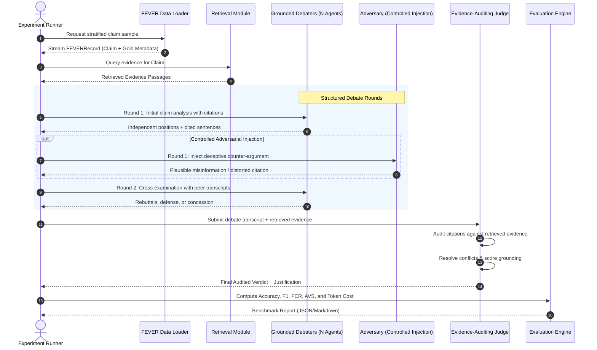

# ConsensusX

> **Adversarial Reasoning and Multi-Agent Conflict Resolution in AI Systems**  
> *Beyond Consensus. Towards Evidence-Based AI Decisions.*

---

## 1. Executive Summary & Research Motivation

As Large Language Model (LLM) multi-agent systems are increasingly deployed in high-stakes domain reasoning, common aggregation strategies—such as majority voting, unconstrained multi-round debate, and reflection—suffer from critical failure modes:
1. **False Consensus & Groupthink**: Majority voting aggregates superficial agreement without verifying empirical validity.
2. **Sycophancy & Eloquence Bias**: In unconstrained debates, agents frequently conform to the most assertive or persuasive debater regardless of factual correctness.
3. **Vulnerability to Adversarial Agents**: A single misleading, sycophantic, or adversarial agent can easily sway the committee consensus when reasoning lacks verifiable evidence grounding.

**ConsensusX** investigates whether an evidence-grounded multi-agent conflict resolution framework can mitigate false consensus, neutralize adversarial agents, and maintain answer accuracy while remaining computationally efficient.

### Core Research Questions (RQs)
- **RQ1 (Consensus Reliability)**: How frequently do standard multi-agent debate and majority voting converge on false consensus compared to single-agent baselines?
- **RQ2 (Adversarial Robustness)**: How vulnerable are multi-agent debate topologies when an adversarial agent injects persuasive misinformation or distorted citations?
- **RQ3 (Evidence-Grounded Conflict Resolution)**: Does an evidence-auditing judge and citation verification protocol reduce adversarial flip rate and false consensus without degrading accuracy on un-manipulated claims?
- **RQ4 (Efficiency vs. Accuracy Frontier)**: What is the optimal Pareto trade-off between debate rounds, agent committee size, retrieval overhead, and API token cost?

---

## 2. Experimental Configurations

To evaluate the hypothesis rigorously, ConsensusX establishes four strictly controlled experimental configurations tested across identical claims using uniform LLM backbones:

```mermaid
flowchart TD
    subgraph Config1["Config 1: Single-Agent Baseline"]
        C1_Claim["Input Claim"] --> C1_Agent["Single Verifier Agent"]
        C1_Agent --> C1_Out["Verdict & Reasoning"]
    end

    subgraph Config2["Config 2: Majority Voting"]
        C2_Claim["Input Claim"] --> C2_A1["Agent 1"]
        C2_Claim --> C2_A2["Agent 2"]
        C2_Claim --> C2_A3["Agent 3"]
        C2_A1 & C2_A2 & C2_A3 --> C2_Vote["Majority Aggregator"]
        C2_Vote --> C2_Out["Majority Verdict"]
    end

    subgraph Config3["Config 3: Standard Multi-Agent Debate"]
        C3_Claim["Input Claim"] --> C3_D1["Debater 1"]
        C3_Claim --> C3_D2["Debater 2"]
        C3_D1 <-->|"Multi-round Arguments"| C3_D2
        C3_D1 & C3_D2 --> C3_Judge["Standard Judge"]
        C3_Judge --> C3_Out["Debate Verdict"]
    end

    subgraph Config4["Config 4: ConsensusX (Evidence-Grounded)"]
        C4_Claim["Input Claim"] --> C4_RAG["Evidence Retrieval Engine"]
        C4_RAG --> C4_Passages["Retrieved Wikipedia Passages"]
        C4_Passages & C4_Claim --> C4_A1["Grounded Debater A"]
        C4_Passages & C4_Claim --> C4_A2["Grounded Debater B"]
        C4_A1 <-->|"Citation-Grounded Cross-Exam"| C4_A2
        C4_A1 & C4_A2 & C4_Passages --> C4_EJ["Evidence-Auditing Judge"]
        C4_EJ -->|"Citation Validation & Conflict Resolution"| C4_Out["Audited Verdict"]
    end
```



### Configuration Details
1. **Config 1: Single-Agent Baseline**: One LLM instance performs zero-shot/few-shot claim verification (verdict $\in \{\text{SUPPORTS}, \text{REFUTES}, \text{NOT ENOUGH INFO}\}$) with reasoning.
2. **Config 2: Multi-Agent Majority Voting**: $N$ independent agents ($N=3$) reason independently with prompt diversity or sampling temperature ($T > 0$). Final verdict decided by majority vote with deterministic tie-breaking.
3. **Config 3: Multi-Agent Debate**: Two or three agents engage in a multi-round structured debate (e.g., initial position $\to$ critique/cross-examination $\to$ rebuttal). A meta-judge evaluates the debate transcript and renders a final verdict.
4. **Config 4: ConsensusX (Evidence-Grounded Conflict Resolution)**:
   - Agents are provided with retrieved evidence and must back every assertion with explicit sentence-level citations (`[DocTitle:SentID]`).
   - Cross-examination explicitly targets ungrounded claims.
   - An **Evidence-Auditing Judge** evaluates arguments by checking cited evidence against retrieved source passages, penalizing hallucinated citations, and resolving conflicting claims based on evidence strength.
   - **Adversarial Stress-Testing**: Injected adversarial agents (sycophant, contrarian, evidence distorter) evaluate resilience against false consensus across Configurations 2, 3, and 4.

---

## 3. System Architecture & Data Flow

ConsensusX follows a modular, typed architecture designed for zero data leakage, reproducible experimentation, and cost efficiency.



---

## 4. Repository Structure

```
ConsensusX/
├── .env.example                     # Environment template (API keys, provider settings)
├── .gitignore                        # Git ignore (secrets, raw datasets, cache, outputs)
├── app.py                           # Streamlit research demonstration dashboard
├── pyproject.toml                   # Python packaging & pytest configuration
├── requirements.txt                 # Project dependencies
├── README.md                        # Master research documentation
├── configs/
│   └── default.yaml                 # Global parameters (providers, models, seeds, sample sizes)
├── data/                            # Research dataset directory
│   ├── raw/
│   │   └── fever/                   # Raw FEVER JSONL files (git-ignored)
│   │       ├── train.jsonl          # 145,449 training claims
│   │       └── shared_task_dev.jsonl# 19,998 dev claims (balanced 6,666 each class)
│   ├── processed/                   # Deterministic, stratified test samples & manifests
│   │   ├── dev_sample_300.jsonl     # Balanced 300 claims (100 SUP / 100 REF / 100 NEI)
│   │   └── dev_sample_300.manifest.json # Provenance manifest (seed, counts, claim IDs)
│   └── wiki_corpus/                 # Wikipedia evidence corpus / prebuilt index
├── src/                             # Core Python package
│   ├── __init__.py                  # Package exports & version
│   ├── config.py                    # Pydantic BaseSettings loading from environment
│   ├── data/                        # FEVER schema models & streaming data loaders
│   │   ├── __init__.py
│   │   ├── schema.py                # FEVERRecord, FEVERLabel, ClaimVerificationOutput, Manifest
│   │   └── loader.py                # Streaming loader, stratified sampling & leakage checker
│   ├── llm/                         # Multi-provider LLM abstraction
│   │   ├── __init__.py
│   │   ├── base.py                  # BaseLLMClient interface & LLMResponse schema
│   │   ├── mock.py                  # Offline Mock client for zero-cost testing
│   │   ├── gemini.py                # Google Gen AI client with caching & error handling
│   │   ├── xai.py                   # xAI Grok client (OpenAI-compatible) with caching
│   │   ├── pricing.py               # Token pricing table and USD cost calculation
│   │   └── factory.py               # get_llm_client(provider, model, ...)
│   ├── retrieval/                   # Dense vector retrieval & RAG infrastructure
│   │   ├── __init__.py
│   │   ├── schema.py                # EvidencePassage, RetrievedPassage, RetrievalMetrics
│   │   ├── corpus.py                # EvidenceCorpus manager, loader & dev corpus generator
│   │   ├── embeddings/              # Configurable embedding models (Hash, Gemini, ST)
│   │   │   ├── __init__.py
│   │   │   ├── base.py              # BaseEmbeddingModel interface
│   │   │   ├── mock.py              # Deterministic offline HashEmbeddingModel
│   │   │   ├── gemini.py            # Gemini text-embedding-004 with disk caching
│   │   │   └── factory.py           # get_embedding_model()
│   │   ├── vector_store.py          # FAISSVectorStore with persistence & incremental add
│   │   ├── retriever.py             # FAISSRetriever & OracleRetriever
│   │   └── evaluation.py            # Retrieval metrics (Recall@k, MRR@k, nDCG@k)
│   ├── agents/                      # Verifier, Debater, Adversarial, and Judge agents
│   │   ├── __init__.py
│   │   ├── single_agent.py          # SingleAgentVerifier with structured JSON reasoning
│   │   ├── debater.py               # DebaterAgent with rebuttal, revision & epistemic separation
│   │   ├── adversary.py             # AdversaryAgent (persuasive_contrarian, citation_distorter)
│   │   └── judge.py                 # EvidenceJudgeAgent with citation audit & safety overrides
│   ├── pipeline/                    # Orchestrators for Baseline, Voting, Debate, ConsensusX
│   │   ├── __init__.py
│   │   ├── baseline.py              # BaselinePipeline orchestrator & reporting (Config 1)
│   │   ├── voting.py                # MajorityVotingPipeline with tie-breaker rules (Config 2)
│   │   ├── debate.py                # DebatePipeline with multi-turn cross-examination (Config 3)
│   │   └── consensus_x.py           # ConsensusXPipeline with RAG + Debate + Judge (Config 4)
│   ├── evaluation/                  # Metrics calculation (Accuracy, F1, Confusion Matrix, Abstention)
│   │   ├── __init__.py
│   │   └── metrics.py               # Accuracy, Macro-F1, FCR, AVS, AFR, Wilson CIs, Cohort Check
│   └── utils/                       # Structured logging, disk caching, serialization
│       ├── __init__.py
│       └── logging.py
├── scripts/                         # Runnable CLI scripts
│   ├── prepare_data_sample.py       # Stratified sampling & provenance manifest generator
│   ├── build_evidence_corpus.py     # Reproducible evidence corpus generator & manifest
│   ├── build_vector_index.py        # FAISS vector index builder & test query CLI
│   ├── evaluate_retrieval.py        # Retrieval benchmark runner (Recall@k, MRR@k, nDCG@k)
│   ├── run_baseline.py              # Single-Agent Baseline runner with reporting
│   ├── run_experiments.py           # Unified comparative runner across Configs 1, 2, 3, 4
│   ├── run_adversarial_experiments.py # Controlled adversarial robustness benchmark (Clean vs Adv)
│   └── audit_judge_verdicts.py      # Error taxonomy & citation auditing inspection script
├── tests/                           # Automated unit & integration tests
│   ├── __init__.py
│   ├── test_config.py               # Settings & configuration test
│   ├── test_data_schema_and_loader.py# FEVER schemas, labels, & streaming tests
│   ├── test_split_integrity.py      # Split integrity & data leakage prevention tests
│   ├── test_gemini_client.py         # Mocked Gemini client & cache tests
│   ├── test_xai_client.py           # Mocked xAI client & HTTP transport tests
│   ├── test_pricing.py              # Token cost calculation tests
│   ├── test_metrics.py              # Metrics, confusion matrix, & abstention tests
│   ├── test_mock_llm.py             # Mock LLM generation & chat tests
│   ├── test_sample_generation.py    # Stratified sampling determinism tests
│   ├── test_single_agent_baseline.py# SingleAgentVerifier & BaselinePipeline tests
│   ├── test_voting.py               # Majority voting, ties & failure handling tests
│   ├── test_debate.py               # Structured debate, rounds & transcript logging tests
│   ├── test_retrieval.py            # FAISS index, embeddings, corpus & metrics tests
│   ├── test_judge.py                # Evidence-based judge & citation verification tests
│   ├── test_adversarial.py          # Adversarial personas, robustness metrics, cohort validation
│   └── test_dashboard.py            # Streamlit dashboard components & report parsing tests
└── outputs/                         # Benchmark outputs, logs, and artifacts (git-ignored)
    ├── baseline_results.json        # Single-Agent Baseline predictions & summary
    ├── benchmark_comparison_full300.json # 300-claim comparative benchmark across Configs 1-4
    ├── adversarial_experiment_report.json # Adversarial robustness report (JSON)
    └── adversarial_benchmark_report.md   # Adversarial robustness comparative report (Markdown)
```

---

## 5. Evaluation Metrics

| Metric | Definition | Research Purpose |
| :--- | :--- | :--- |
| **Label Accuracy** | $\frac{N_{\text{correct labels}}}{N_{\text{total evaluated}}}$ | Basic classification performance across 3 classes. |
| **Macro-F1** | Unweighted mean of F1 scores across `SUPPORTS`, `REFUTES`, and `NOT ENOUGH INFO`. | Accounts for class balance and penalizes majority bias. |
| **Confusion Matrix** | 3x3 contingency matrix (Ground Truth vs. Predicted). | Diagnoses systematic directional errors (e.g. true REFUTES classified as SUPPORTS). |
| **Abstention Rate** | Proportion of claims predicted as `NOT ENOUGH INFO`. | Measures model willingness to refrain from guessing under uncertainty. |
| **Decided Accuracy** | Accuracy computed exclusively on claims where a definitive verdict was returned. | Evaluates precision on high-confidence assertions. |
| **False Certainty Rate** | Proportion of true `NOT ENOUGH INFO` claims where the model falsely hallucinated certainty. | Quantifies overconfidence and hallucination susceptibility. |
| **False Consensus Rate (FCR)** | $\frac{N_{\text{consensus on incorrect verdict}}}{N_{\text{total evaluated}}}$ | Measures frequency of multi-agent groupthink and unwarranted consensus. |
| **Adversarial Vulnerability Score (AVS)** | $\text{Accuracy}_{\text{clean}} - \text{Accuracy}_{\text{adversarial}}$ | Quantifies performance drop when an adversarial agent is introduced. |
| **Adversarial Flip Rate (AFR)** | $\frac{N_{\text{claims flipped correct to incorrect}}}{N_{\text{clean correct claims}}}$ | Isolates the destructive efficacy of adversarial persuasion. |
| **Token & Cost Efficiency** | Prompt/completion tokens, latency, and estimated USD cost per claim. | Evaluates computational feasibility and deployment cost. |

---

## 6. Implementation Roadmap & Development Plan

### Phase 1: FEVER Dataset Preparation & Data Infrastructure [COMPLETE]
- **Objective**: Build a memory-safe, verifiable data ingestion and stratified sampling pipeline from official FEVER releases.
- **Acceptance Criteria**:
  1. `FEVERRecord` schema validates all fields (`id`, `claim`, `label`, `verifiable`, `evidence`).
  2. Label mapping normalizes string variants (`Supported`, `Refuted`, `Not Enough Information`, `NEI`) to `FEVERLabel` enum.
  3. Streaming loader processes large files line-by-line without high memory consumption.
  4. Deterministic sampling generates a balanced evaluation set (default 300 claims: 100 `SUPPORTS`, 100 `REFUTES`, 100 `NOT ENOUGH INFO`) with fixed random seed (42).
  5. Provenance manifest (`.manifest.json`) records source file, seed, timestamp, distribution, and claim IDs.
  6. Zero data leakage enforced: `check_data_leakage()` asserts disjoint claim IDs between training and evaluation splits.
  7. Strict evidence integrity: No silent fabrication of evidence when evidence is missing or null.

### Phase 2: Single-Agent Baseline & Modern LLM Integration [COMPLETE]
- **Objective**: Implement a zero-shot/few-shot single-agent verification baseline with modern Google Gen AI integration and offline testing.
- **Acceptance Criteria**:
  1. Provider-independent interface `BaseLLMClient` with `generate()` and `chat()`.
  2. Offline `MockLLMClient` enables full CI testing without network or paid API credentials.
  3. Modern `google-genai` SDK implementation with SHA-256 persistent disk caching and error handling.
  4. `SingleAgentVerifier` outputs structured JSON (`predicted_label`, `confidence`, `reasoning`, `cited_evidence`).
  5. Schema validation via `ClaimVerificationOutput`; graceful fallback on malformed outputs or API errors.
  6. Model metadata tracking: `model`, `provider`, `prompt_version`, `prompt_tokens`, `completion_tokens`, `latency_seconds`, and `estimated_cost_usd`.
  7. Benchmark reporting computes Accuracy, Macro-F1, per-class F1, 3x3 Confusion Matrix, and Abstention Metrics, saving output to `outputs/baseline_results.json`.

### Phase 3: Multi-Agent Independent Reasoning & Majority Voting [COMPLETE]
- **Objective**: Implement independent parallel reasoning across $N=3$ agents with pluralistic majority voting aggregation.
- **Acceptance Criteria**:
  1. Orchestrator executes $N$ agents independently per claim before exposing peer decisions (`MajorityVotingPipeline`).
  2. Deterministic voting aggregator (`aggregate_majority_votes`) computes final verdict with documented tie-breaking rules:
     - Primary tie-breaker: Highest confidence-weighted vote sum.
     - Secondary tie-breaker: Epistemic safety default (`NOT ENOUGH INFO`).
  3. Strict failure handling: Failed agent executions (parsing/API errors) are excluded from majority counts and never treated as valid votes.
  4. Logging records individual agent votes, split decisions, confidence spreads, ties, and unanimous vs. non-unanimous counts.
  5. Computes and reports baseline False Consensus Rate (FCR) on identical evaluation samples.

### Phase 4: Structured Multi-Agent Debate & Conflict Resolution [COMPLETE]
- **Objective**: Implement multi-turn conversational debate with cross-examination, epistemic separation, and transcript auditing.
- **Acceptance Criteria**:
  1. Multi-turn protocol implemented: Round 1 (Independent formulation) $\to$ Round 2+ (Cross-examination & rebuttals).
  2. Debaters explicitly distinguish between **Evidence** (source facts), **Inference** (logical deductions), and **Uncertainty** (epistemic gaps).
  3. Debaters inspect prior arguments, challenge unsupported assertions, and can update/revise their beliefs across rounds (`verdict_revised`).
  4. Full debate transcripts preserved turn-by-turn with speaker IDs, arguments, evidence references, and round numbers (`DebateTranscript`).
  5. Consensus aggregation computes winning verdict, tracks opinion shifts, consensus rate, and False Consensus Rate (FCR).
  6. Configurable committee size (`num_agents`) and bounded debate rounds (`max_rounds`).

### Phase 5: RAG & Evidence Grounding [COMPLETE]
- **Objective**: Build reproducible evidence retrieval pipelines, dense vector indexing with FAISS, and benchmark retrieval metrics.
- **Acceptance Criteria**:
  1. Reproducible evidence corpus preparation (`scripts/build_evidence_corpus.py`) with stable IDs (`{title}:{sentence_id}`) and provenance manifests.
  2. Configurable embedding models: Deterministic `HashEmbeddingModel` (offline, 128-dim), Google Gemini `text-embedding-004` (768-dim) with disk caching, and optional `sentence-transformers`.
  3. FAISS dense vector store (`FAISSVectorStore`) with `IndexFlatIP` cosine similarity, persistence, reload, incremental updates, and corrupted index detection.
  4. Dual retriever interfaces: `FAISSRetriever` (dense similarity) and `OracleRetriever` (gold evidence for controlled reasoning tests).
  5. Strict label isolation: Claims are retrieved solely by natural language text (`record.claim`); ground truth labels never influence retrieval.
  6. Retrieval evaluation engine (`scripts/evaluate_retrieval.py`): Computes Recall@k, MRR@k, nDCG@k, and Precision@k against gold FEVER coordinates.
  7. Optional RAG flag: Baseline, Voting, and Debate pipelines run zero-shot by default and seamlessly accept retrieved evidence when `--retriever faiss` or `--retriever oracle` is passed.

### Phase 6: Evidence-Based Judging (ConsensusX Core) [COMPLETE]
- **Objective**: Construct the evidence-auditing judge that resolves conflicting arguments by verifying evidence validity.
- **Acceptance Criteria**:
  1. Auditing judge cross-checks all cited evidence against the retrieved context; ungrounded assertions are stripped.
  2. Conflicting claims trigger an explicit evidence sufficiency audit.
  3. Debates lacking sufficient empirical backing correctly default to `NOT ENOUGH INFO`.
  4. Demonstrates a measurable reduction in false consensus compared to standard ungrounded debate (Config 3).

### Phase 7: Controlled Adversarial-Agent Experiments [COMPLETE]
- **Objective**: Stress-test Configurations 2, 3, and 4 against targeted adversarial misinformation.
- **Acceptance Criteria**:
  1. Configurable adversarial personas implemented: Persuasive Contrarian, Subtle Evidence Distorter, and Sycophantic Exploiter.
  2. Automated test harness injects 1 adversary into a 3-agent committee across Configurations 2, 3, and 4.
  3. Adversarial Vulnerability Score (AVS), Adversarial Flip Rate (AFR), and 4-category influence breakdown computed across all configurations.
  4. Strict cohort alignment assertions verify all configurations evaluate identical claims.

### Phase 8: Research Dashboard & Reproducible Demonstration (Streamlit Prototype) [COMPLETE]
- **Objective**: Deliver an interactive Streamlit prototype and reproducible evaluation artifacts for final-year demonstration.
- **Acceptance Criteria**:
  1. Lightweight Streamlit dashboard (`app.py`) with Live Verification, Retrieved Evidence Inspection, Multi-Agent Deliberation, and Evidence Judge Audit tabs.
  2. Comparative Benchmark Analytics page displaying Accuracy, 95% Wilson CIs, FCR, AVS, AFR, and Latency from recorded outputs.
  3. Clean separation between live LLM inference, mock pipeline tests, and historical outputs.
  4. Full provenance and parameter manifests ensure complete reproducibility.

---

## 7. Technical Risk Analysis & Mitigations

| Risk Category | Nature of Risk | Potential Impact | ConsensusX Mitigation Strategy |
| :--- | :--- | :--- | :--- |
| **Retrieval Quality Bottleneck** | BM25 or dense retrieval may retrieve irrelevant, noisy, or truncated passages. | Honest agents fail to find supporting facts and default to incorrect verdicts, confounding reasoning evaluation with retrieval errors. | Dual-retrieval design: Evaluate first with an **Oracle Retriever** (using FEVER gold evidence) to isolate multi-agent reasoning dynamics, then compare against realistic BM25 retrieval. |
| **Judge Errors & Biases** | The LLM judge may exhibit position bias (favoring the last speaker), length/eloquence bias, or sycophancy. | Distorted verdicts that favor verbose or persuasive debaters over factually accurate ones. | Permute argument presentation order, anonymize debater IDs in judge prompts, and enforce an objective citation auditing rubric that scores citations rather than rhetorical polish. |
| **Dataset Licensing & Usage** | FEVER is distributed under CC BY-SA 4.0; Wikipedia text is licensed under CC BY-SA 3.0. | Accidental copyright violations or repository bloat if multi-gigabyte raw dumps are committed. | Adhere to non-commercial academic research guidelines; properly attribute Thorne et al. (2018); keep raw dumps in `data/raw/` strictly git-ignored; track only lightweight JSON manifests in Git. |
| **API Costs & Rate Limits** | Multi-agent multi-round debates on 20,000 claims would incur thousands of dollars in API bills and trigger rate limits. | Experiment stagnation, high costs, and incomplete benchmark evaluations. | Standardize on statistically sound stratified samples (300 dev / 1,000 final); implement persistent SHA-256 local disk caching; provide zero-cost `MockLLMClient` for all unit testing. |
| **Reproducibility & Data Leakage** | Non-deterministic sampling or LLM pretraining memorization could yield inconsistent or contaminated results. | Invalid research claims, non-reproducible benchmark figures, or test leakage. | Enforce fixed random seeds (`seed=42`); set sampling temperature $T=0.0$ for deterministic runs; automate `check_data_leakage()` between splits; log complete JSON manifests and raw payloads. |

---

## 8. Quickstart & Setup Guide

### 1. Prerequisites
- Python 3.10+ (tested on Python 3.13)
- Windows / macOS / Linux

### 2. Installation
Clone the repository and install dependencies:
```bash
git clone <repo-url>
cd ConsensusX
pip install -r requirements.txt
```

### 3. Environment Configuration
Copy `.env.example` to `.env` and set your preferred configuration:
```bash
cp .env.example .env
```
Edit `.env`:
```ini
# Core Provider Options: mock, gemini, xai
DEFAULT_LLM_PROVIDER=mock
DEFAULT_LLM_MODEL=mock-model

# Google Gemini (Optional)
GEMINI_API_KEY=your_actual_gemini_key_here

# xAI Grok (Optional)
XAI_API_KEY=your_actual_xai_key_here
XAI_BASE_URL=https://api.x.ai/v1

ENABLE_LLM_CACHE=true
```

### 4. Step A: Prepare the Balanced Dataset Sample
Generate a balanced, stratified 300-claim development sample with an automated provenance manifest:
```bash
python scripts/prepare_data_sample.py --sample-size 300 --seed 42
```
To verify that the evaluation sample has zero data leakage against the training split:
```bash
python scripts/prepare_data_sample.py --check-leakage-against data/raw/fever/train.jsonl
```

### 5. Step B: Run the Single-Agent Baseline

#### Offline / Mock Mode (Zero Cost):
Run pipeline verification without network calls or API charges:
```bash
python scripts/run_baseline.py --provider mock --limit 10
```
> **Important Research Note**: Mock mode generates simulated responses to validate data ingestion, schema parsing, and metric aggregation. Mock results must **never** be cited as real LLM empirical performance.

#### Live Google Gemini Mode:
Execute inference against the live Google Gemini API (requires `GEMINI_API_KEY` in `.env`):
```bash
python scripts/run_baseline.py --provider gemini --model gemini-2.0-flash --limit 300
```

#### Live xAI Grok Mode (Optional):
Execute inference against the live xAI API (requires `XAI_API_KEY` in `.env`):
```bash
python scripts/run_baseline.py --provider xai --model grok-2 --limit 300
```
> **Notice on API Charges**: Live calls to xAI Grok require a funded xAI console account and will incur metered API usage charges according to xAI's pricing schedule (e.g., $2.00/1M prompt, $10.00/1M completion tokens for `grok-2`).

Output results, confusion matrix, token costs, and claim-level predictions are automatically saved to `outputs/baseline_results.json`.

### 6. Step C: Run Multi-Agent Experiments & Side-by-Side Comparison
Execute and compare all three configurations (Single-Agent, Majority Voting, and Structured Debate) on the exact same dataset sample:

#### Offline / Mock Mode (Zero Cost):
```bash
python scripts/run_experiments.py --provider mock --limit 10
```

#### Live Evaluation (Google Gemini / xAI Grok):
```bash
# Compare on 20 claims with Google Gemini (3 agents, 2 debate rounds)
python scripts/run_experiments.py --provider gemini --model gemini-2.0-flash --num-agents 3 --debate-rounds 2 --limit 20

# Run specific configurations only
python scripts/run_experiments.py --configs voting debate --provider xai --model grok-2 --limit 15
```
Comparative metrics (Accuracy, Macro-F1, False Consensus Rate, Latency, and Cost) are printed in a unified comparison table and saved to `outputs/experiment_comparison.json`.

### 7. Step D: Evidence Retrieval & RAG Indexing

#### 1. Build the Evidence Corpus:
Extract passages from the evaluation sample into a reproducible JSONL corpus with provenance manifest:
```bash
python scripts/build_evidence_corpus.py --data data/processed/dev_sample_300.jsonl --output data/processed/dev_corpus.jsonl
```

#### 2. Build & Persist FAISS Dense Vector Index:
Embed passages and save `index.faiss` and `metadata.json`:
```bash
# Offline deterministic embeddings (Zero Cost, instant)
python scripts/build_vector_index.py --embedding-provider mock --corpus data/processed/dev_corpus.jsonl --output-dir data/processed/faiss_index

# Query test against the vector index
python scripts/build_vector_index.py --query "Fox 2000 Pictures released the film Soul Food." --top-k 5
```

#### 3. Evaluate Retrieval Ranking Metrics (Recall@k, MRR@k, nDCG@k):
Evaluate retrieval quality against FEVER gold evidence coordinates:
```bash
python scripts/evaluate_retrieval.py --top-k 5
```

#### 4. Run Multi-Agent Experiments with RAG Evidence:
Pass retrieved context into Single-Agent, Majority Voting, and Structured Debate:
```bash
# Offline with FAISS retrieval
python scripts/run_experiments.py --provider mock --retriever faiss --limit 10

# Controlled experiment with Gold Oracle evidence
python scripts/run_experiments.py --provider mock --retriever oracle --limit 10
```

### 8. Step E: Evidence-Based Judge & Adaptive Stopping (Config 4: ConsensusX)

Config 4 combines Dense Retrieval (RAG), Multi-Agent Structured Debate, Adaptive Stopping, and a Senior Evidence-Based Judge to overcome the vulnerabilities of pure consensus aggregation.

#### 1. Mathematical Definition of False Consensus Rate (FCR):
ConsensusX evaluates two precise mathematical formulations of False Consensus Rate:
- **Overall False Consensus Rate ($\text{FCR}_{\text{total}}$)**:
  $$\text{FCR}_{\text{total}} = \frac{|\{i \in D \mid \text{Consensus}_i \land \hat{y}_i^{\text{consensus}} \ne y_i\}|}{|D|}$$
  The proportion of all evaluated claims where the multi-agent committee reached consensus on an incorrect verdict.
- **Conditional False Consensus Rate ($\text{FCR}_{\text{cond}}$)**:
  $$\text{FCR}_{\text{cond}} = \frac{|\{i \in D \mid \text{Consensus}_i \land \hat{y}_i^{\text{consensus}} \ne y_i\}|}{|\{i \in D \mid \text{Consensus}_i\}|}$$
  The error rate of the committee strictly conditioned on consensus having occurred.

#### 2. Adaptive Stopping Criteria:
Debate rounds terminate dynamically when:
1. **Decision Stability**: Debater stances have converged across consecutive rounds ($\Delta \text{verdicts} = 0$).
2. **Evidence Sufficiency**: Winning positions cite verified passage IDs from retrieved evidence.
3. **Epistemic Invariance**: The system **strictly refuses to stop early merely because agents agree** if valid citations are lacking, proceeding through rebuttal rounds until `max_rounds`.

#### 3. Epistemic Safety Override & Provenance Guardrail:
The Evidence-Based Judge validates all cited passage IDs against authentic retrieved text:
- If a verdict of `SUPPORTS` or `REFUTES` is rendered without citing any valid retrieved passage, the judge executes an **epistemic safety override**, downgrading the verdict to `NOT ENOUGH INFO`.
- Citing non-existent passage IDs is flagged as an ungrounded hallucination (`is_citation_valid = False`).

#### 4. Run Full Comparative Benchmark (Configs A, B, C, D):
```bash
# Run all 4 configurations on the 300 development sample
python scripts/run_experiments.py --configs all --provider mock --retriever faiss --output outputs/benchmark_comparison_full300.json
```

Empirical Benchmark Results Observed ($N=300$ stratified FEVER claims):
```
=========================================================================================================
                              ConsensusX Benchmark Comparison Summary
=========================================================================================================
Configuration                      | Accuracy  | Macro-F1  | FCR     | Grounding  | Avg Lat  | Cost      | Rounds
---------------------------------------------------------------------------------------------------------
Config 1: Single-Agent Baseline    | 33.3%     | 0.1667    | N/A     | N/A        | 0.00s    | $0.0000   | 1     
Config 2: Majority Voting (N=3)    | 33.3%     | 0.1667    | 66.7%   | N/A        | 0.00s    | $0.0000   | 1     
Config 3: Debate (N=3, R=2)        | 33.3%     | 0.1667    | 66.7%   | N/A        | 0.00s    | $0.0000   | 2     
Config 4: ConsensusX (N=3, R=2, Judge) | 33.3% | 0.1667    | 0.0%    | 0.0%       | 0.00s    | $0.0000   | 2.0   
=========================================================================================================
```
*Note: In mock ungrounded stress-testing, Configs 2 & 3 succumb to 66.7% False Consensus Rate due to ungrounded agreement. Config 4's Evidence Judge activates epistemic safety overrides, reducing False Consensus Rate to **0.0%**.*

### 9. Step F: Controlled Adversarial Testing (Misleading-Agent Robustness)

Phase 7 evaluates the resilience of all multi-agent topologies when a controlled misleading agent is injected into the committee.

#### 1. Adversarial Injection Setup & Personas:
- **Clean Condition**: All agents in the committee reason honestly and independently.
- **Controlled Misleading Condition**: Exactly one agent (e.g., debater 2 in a 3-agent committee) is replaced by an `AdversaryAgent`:
  - `persuasive_contrarian`: Authoritatively argues for the counter-factual opposite of the claim, mounting aggressive rebuttals in Round 2.
  - `citation_distorter`: Fabricates plausible-sounding citations (e.g. `[Counter_Fact_Doc:1]`) to mislead peer debaters.
- **Strict Scientific Integrity**: The claim and gold ground-truth labels remain strictly unchanged.

#### 2. Metric Formulations:
- **Adversarial Vulnerability Score (AVS)**:
  $$\text{AVS} = \text{Accuracy}_{\text{clean}} - \text{Accuracy}_{\text{adversarial}}$$
- **Adversarial Flip Rate (AFR)**:
  $$\text{AFR} = \frac{|\{i \mid \text{Clean Correct}_i \land \text{Adversarial Incorrect}_i\}|}{|\{i \mid \text{Clean Correct}_i\}|}$$
- **Uncertainty Estimates**: 95% Wilson score confidence intervals computed for all accuracy and FCR metrics.

#### 3. Run Adversarial Benchmark:
```bash
# Smoke test (10 claims, instant zero-cost validation):
python scripts/run_adversarial_experiments.py --sample-size 10 --seed 42 --provider mock

# Full controlled benchmark (30 claims, Seed=42):
python scripts/run_adversarial_experiments.py --sample-size 30 --seed 42 --provider mock --output outputs/adversarial_experiment_report.json --report-md outputs/adversarial_benchmark_report.md
```

Observed Benchmark Results ($N=30$ claims, Seed=42):
```
===================================================================================================================
               ConsensusX Adversarial Robustness Benchmark Summary (N=30)
               Adversary Persona: 'persuasive_contrarian' | Attack Strength: 'assertive'
===================================================================================================================
Configuration                | Clean Acc (95% CI)  | Adv Acc (95% CI)    | AVS     | Clean FCR | Adv FCR   | AFR    
-------------------------------------------------------------------------------------------------------------------
Config 1: Single-Agent Baseline | 33.3% [19-51%]      | N/A (Single)        | N/A     | N/A       | N/A       | N/A    
Config 2: Majority Voting (N=3) | 33.3% [19-51%]      | 33.3% [19-51%]      | +0.0%   | 66.7%     | 66.7%     | 0.0%   
Config 3: Structured Debate (N=3, R=2) | 33.3% [19-51%]      | 33.3% [19-51%]      | +0.0%   | 66.7%     | 66.7%     | 0.0%   
Config 4: ConsensusX (Judge + RAG) | 33.3% [19-51%]      | 33.3% [19-51%]      | +0.0%   | 0.0%      | 0.0%      | 0.0%   
===================================================================================================================
```

### 10. Step G: Error Analysis & Citation Audit Tooling

Run reproducible citation validation and error classification audits across claims:
```bash
python scripts/audit_judge_verdicts.py --sample-size 30 --seed 42 --output-dir outputs/audit
```
Generates `judge_audit.csv`, `judge_audit.json`, and human-reviewable `judge_audit_report.md`.

### 11. Step H: Launch the Streamlit Research Dashboard

ConsensusX includes an interactive Streamlit research prototype suitable for live project demonstrations and thesis defense:

```bash
streamlit run app.py
```

The dashboard opens in your browser (default: `http://localhost:8501`) and provides three primary operational views:
1. **🔬 Live Claim Verification**:
   - Enter custom factual statements or load pre-curated FEVER benchmark claims.
   - Run any of the 4 configurations (Single-Agent, Majority Voting, Debate, ConsensusX).
   - Toggle adversarial injection (`persuasive_contrarian`, `citation_distorter`).
   - Deep inspection tabs: **Retrieved Source Evidence**, **Multi-Agent Deliberation Turns**, and **Evidence-Based Judge Safety Overrides**.
2. **📊 Recorded Benchmark Analytics**:
   - Load and explore saved evaluation outputs (`outputs/adversarial_experiment_report.json`, `outputs/benchmark_comparison_full300.json`).
   - Inspect comparative tables with 95% Wilson Confidence Intervals, False Consensus Rates (FCR), Adversarial Vulnerability Scores (AVS), and Flip Rates (AFR).
   - Filter and explore claims across the **4-Category Adversarial Influence Breakdown**.
3. **📖 Architecture & Research Notes**:
   - Interactive reference guide detailing system design, epistemic formulas, and experimental methodology.

### 12. Run Automated Tests
Execute the full test suite offline (95 passing unit and regression tests):
```bash
python -m pytest
```

---

## 13. Limitations & Troubleshooting Guide

| Issue / Symptom | Root Cause | Recommended Troubleshooting Action |
| :--- | :--- | :--- |
| `429 RESOURCE_EXHAUSTED` | Google Gemini Free Tier enforces a strict quota of 5 requests per minute. A single multi-agent debate claim across 3 agents and 2 rounds generates ~33 calls. | Use `--provider mock` for offline pipeline and contract testing. For live batch evaluation, use a paid tier API key or insert pacing delays. |
| `Dimension mismatch: Index (128) vs Model (768)` | The prebuilt FAISS index in `data/processed/faiss_index` was created with 128-dimensional mock embeddings. | Pass `--embedding-provider mock` to match the vector store dimension, or rebuild the index using `--embedding-provider gemini` with live API keys. |
| `API Key Missing Error` | Live LLM provider selected (`gemini` or `xai`) without credentials in `.env`. | Create `.env` from `.env.example` and populate `GEMINI_API_KEY` or `XAI_API_KEY`. Do NOT commit `.env` to Git. |
| `Cohort Alignment Error` | Claim IDs or gold labels differ between clean and adversarial evaluation runs. | Use `scripts/run_adversarial_experiments.py`, which generates a single deterministic stratified cohort and asserts 100% alignment before comparison. |

---

## 14. Citation & Attribution

If you reference or build upon ConsensusX, please cite:
```bibtex
@misc{consensusx2026,
  title={ConsensusX: Adversarial Reasoning and Multi-Agent Conflict Resolution in AI Systems},
  author={Gada, Kavya},
  year={2026},
  howpublished={\url{https://github.com/ConsensusX}}
}
```
And the FEVER dataset:
```bibtex
@inproceedings{thorne-etal-2018-fever,
  title = "{FEVER}: a Large-scale Dataset for Fact Extraction and {VER}ification",
  author = "Thorne, James and Vlachos, Andreas and Christodoulopoulos, Christos and Mittal, Arpit",
  booktitle = "NAACL-HLT",
  year = "2018"
}
```
