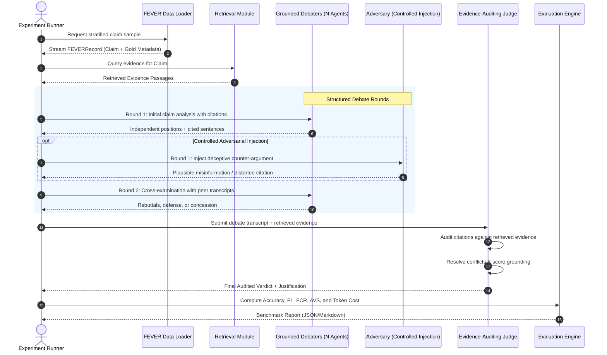

# ConsensusX

> **Adversarial Reasoning and Multi-Agent Conflict Resolution in AI Systems**  
> *Beyond Consensus. Towards Evidence-Based AI Decisions.*

---

## 1. Executive Summary & Research Motivation

As Large Language Model (LLM) multi-agent systems are increasingly deployed in high-stakes domain reasoning, common aggregation strategies—such as majority voting, unconstrained multi-round debate, and reflection—suffer from critical failure modes:
1. **False Consensus & Groupthink**: Majority voting aggregates superficial agreement without verifying empirical validity.
2. **Sycophancy & Eloquence Bias**: In unconstrained debates, agents frequently conform to the most assertive or persuasive debater regardless of factual correctness.
3. **Vulnerability to Adversarial Agents**: A single misleading, sycophantic, or adversarial agent can easily sway the committee consensus when reasoning lacks verifiable evidence grounding.

**ConsensusX** investigates whether an evidence-grounded multi-agent conflict resolution framework can mitigate false consensus, neutralize adversarial agents, and maintain answer accuracy while remaining computationally efficient.

### Core Research Questions (RQs)
- **RQ1 (Consensus Reliability)**: How frequently do standard multi-agent debate and majority voting converge on false consensus compared to single-agent baselines?
- **RQ2 (Adversarial Robustness)**: How vulnerable are multi-agent debate topologies when an adversarial agent injects persuasive misinformation or distorted citations?
- **RQ3 (Evidence-Grounded Conflict Resolution)**: Does an evidence-auditing judge and citation verification protocol reduce adversarial flip rate and false consensus without degrading accuracy on un-manipulated claims?
- **RQ4 (Efficiency vs. Accuracy Frontier)**: What is the optimal Pareto trade-off between debate rounds, agent committee size, retrieval overhead, and API token cost?

---

## 2. Experimental Configurations

To evaluate the hypothesis rigorously, ConsensusX establishes four strictly controlled experimental configurations tested across identical claims using uniform LLM backbones:

```mermaid
flowchart TD
    subgraph Config1["Config 1: Single-Agent Baseline"]
        C1_Claim["Input Claim"] --> C1_Agent["Single Verifier Agent"]
        C1_Agent --> C1_Out["Verdict & Reasoning"]
    end

    subgraph Config2["Config 2: Majority Voting"]
        C2_Claim["Input Claim"] --> C2_A1["Agent 1"]
        C2_Claim --> C2_A2["Agent 2"]
        C2_Claim --> C2_A3["Agent 3"]
        C2_A1 & C2_A2 & C2_A3 --> C2_Vote["Majority Aggregator"]
        C2_Vote --> C2_Out["Majority Verdict"]
    end

    subgraph Config3["Config 3: Standard Multi-Agent Debate"]
        C3_Claim["Input Claim"] --> C3_D1["Debater 1"]
        C3_Claim --> C3_D2["Debater 2"]
        C3_D1 <-->|"Multi-round Arguments"| C3_D2
        C3_D1 & C3_D2 --> C3_Judge["Standard Judge"]
        C3_Judge --> C3_Out["Debate Verdict"]
    end

    subgraph Config4["Config 4: ConsensusX (Evidence-Grounded)"]
        C4_Claim["Input Claim"] --> C4_RAG["Evidence Retrieval Engine"]
        C4_RAG --> C4_Passages["Retrieved Wikipedia Passages"]
        C4_Passages & C4_Claim --> C4_A1["Grounded Debater A"]
        C4_Passages & C4_Claim --> C4_A2["Grounded Debater B"]
        C4_A1 <-->|"Citation-Grounded Cross-Exam"| C4_A2
        C4_A1 & C4_A2 & C4_Passages --> C4_EJ["Evidence-Auditing Judge"]
        C4_EJ -->|"Citation Validation & Conflict Resolution"| C4_Out["Audited Verdict"]
    end
```



### Configuration Details
1. **Config 1: Single-Agent Baseline**: One LLM instance performs zero-shot/few-shot claim verification (verdict $\in \{\text{SUPPORTS}, \text{REFUTES}, \text{NOT ENOUGH INFO}\}$) with reasoning.
2. **Config 2: Multi-Agent Majority Voting**: $N$ independent agents ($N=3$) reason independently with prompt diversity or sampling temperature ($T > 0$). Final verdict decided by majority vote with deterministic tie-breaking.
3. **Config 3: Multi-Agent Debate**: Two or three agents engage in a multi-round structured debate (e.g., initial position $\to$ critique/cross-examination $\to$ rebuttal). A meta-judge evaluates the debate transcript and renders a final verdict.
4. **Config 4: ConsensusX (Evidence-Grounded Conflict Resolution)**:
   - Agents are provided with retrieved evidence and must back every assertion with explicit sentence-level citations (`[DocTitle:SentID]`).
   - Cross-examination explicitly targets ungrounded claims.
   - An **Evidence-Auditing Judge** evaluates arguments by checking cited evidence against retrieved source passages, penalizing hallucinated citations, and resolving conflicting claims based on evidence strength.
   - **Adversarial Stress-Testing**: Injected adversarial agents (sycophant, contrarian, evidence distorter) evaluate resilience against false consensus across Configurations 2, 3, and 4.

---

## 3. System Architecture & Data Flow

ConsensusX follows a modular, typed architecture designed for zero data leakage, reproducible experimentation, and cost efficiency.



---

## 4. Repository Structure

```
ConsensusX/
├── .env.example                     # Environment template (API keys, provider settings)
├── .gitignore                        # Git ignore (secrets, raw datasets, cache, outputs)
├── pyproject.toml                   # Python packaging & pytest configuration
├── requirements.txt                 # Project dependencies
├── README.md                        # Master research documentation
├── configs/
│   └── default.yaml                 # Global parameters (providers, models, seeds, sample sizes)
├── data/                            # Research dataset directory
│   ├── raw/
│   │   └── fever/                   # Raw FEVER JSONL files (git-ignored)
│   │       ├── train.jsonl          # 145,449 training claims
│   │       └── shared_task_dev.jsonl# 19,998 dev claims (balanced 6,666 each class)
│   ├── processed/                   # Deterministic, stratified test samples & manifests
│   │   ├── dev_sample_300.jsonl     # Balanced 300 claims (100 SUP / 100 REF / 100 NEI)
│   │   └── dev_sample_300.manifest.json # Provenance manifest (seed, counts, claim IDs)
│   └── wiki_corpus/                 # Wikipedia evidence corpus / prebuilt index
├── src/                             # Core Python package
│   ├── __init__.py                  # Package exports & version
│   ├── config.py                    # Pydantic BaseSettings loading from environment
│   ├── data/                        # FEVER schema models & streaming data loaders
│   │   ├── __init__.py
│   │   ├── schema.py                # FEVERRecord, FEVERLabel, ClaimVerificationOutput, Manifest
│   │   └── loader.py                # Streaming loader, stratified sampling & leakage checker
│   ├── llm/                         # Multi-provider LLM abstraction
│   │   ├── __init__.py
│   │   ├── base.py                  # BaseLLMClient interface & LLMResponse schema
│   │   ├── mock.py                  # Offline Mock client for zero-cost testing
│   │   ├── gemini.py                # Google Gen AI client with caching & error handling
│   │   ├── pricing.py               # Token pricing table and USD cost calculation
│   │   └── factory.py               # get_llm_client(provider, model, ...)
│   ├── retrieval/                   # Evidence retrieval interface (Oracle & BM25)
│   ├── agents/                      # Verifier, Debater, Adversarial, and Judge agents
│   │   ├── __init__.py
│   │   └── single_agent.py          # SingleAgentVerifier with structured JSON reasoning
│   ├── pipeline/                    # Orchestrators for Baseline, Voting, Debate, ConsensusX
│   │   ├── __init__.py
│   │   └── baseline.py              # BaselinePipeline orchestrator & reporting
│   ├── evaluation/                  # Metrics calculation (Accuracy, F1, Confusion Matrix, Abstention)
│   │   ├── __init__.py
│   │   └── metrics.py               # Accuracy, Macro-F1, Confusion Matrix, Abstention Metrics
│   └── utils/                       # Structured logging, disk caching, serialization
│       ├── __init__.py
│       └── logging.py
├── scripts/                         # Runnable CLI scripts
│   ├── prepare_data_sample.py       # Stratified sampling & provenance manifest generator
│   └── run_baseline.py              # Single-Agent Baseline runner with reporting
├── tests/                           # Automated unit & integration tests
│   ├── __init__.py
│   ├── test_config.py               # Settings & configuration test
│   ├── test_data_schema_and_loader.py# FEVER schemas, labels, & streaming tests
│   ├── test_split_integrity.py      # Split integrity & data leakage prevention tests
│   ├── test_gemini_client.py         # Mocked Gemini client & cache tests
│   ├── test_pricing.py              # Token cost calculation tests
│   ├── test_metrics.py              # Metrics, confusion matrix, & abstention tests
│   ├── test_mock_llm.py             # Mock LLM generation & chat tests
│   ├── test_sample_generation.py    # Stratified sampling determinism tests
│   └── test_single_agent_baseline.py# SingleAgentVerifier & BaselinePipeline tests
└── outputs/                         # Benchmark outputs, logs, and artifacts (git-ignored)
    └── baseline_results.json        # Single-Agent Baseline predictions & summary
```

---

## 5. Evaluation Metrics

| Metric | Definition | Research Purpose |
| :--- | :--- | :--- |
| **Label Accuracy** | $\frac{N_{\text{correct labels}}}{N_{\text{total evaluated}}}$ | Basic classification performance across 3 classes. |
| **Macro-F1** | Unweighted mean of F1 scores across `SUPPORTS`, `REFUTES`, and `NOT ENOUGH INFO`. | Accounts for class balance and penalizes majority bias. |
| **Confusion Matrix** | 3x3 contingency matrix (Ground Truth vs. Predicted). | Diagnoses systematic directional errors (e.g. true REFUTES classified as SUPPORTS). |
| **Abstention Rate** | Proportion of claims predicted as `NOT ENOUGH INFO`. | Measures model willingness to refrain from guessing under uncertainty. |
| **Decided Accuracy** | Accuracy computed exclusively on claims where a definitive verdict was returned. | Evaluates precision on high-confidence assertions. |
| **False Certainty Rate** | Proportion of true `NOT ENOUGH INFO` claims where the model falsely hallucinated certainty. | Quantifies overconfidence and hallucination susceptibility. |
| **False Consensus Rate (FCR)** | $\frac{N_{\text{consensus on incorrect verdict}}}{N_{\text{total evaluated}}}$ | Measures frequency of multi-agent groupthink and unwarranted consensus. |
| **Adversarial Vulnerability Score (AVS)** | $\text{Accuracy}_{\text{clean}} - \text{Accuracy}_{\text{adversarial}}$ | Quantifies performance drop when an adversarial agent is introduced. |
| **Token & Cost Efficiency** | Prompt/completion tokens, latency, and estimated USD cost per claim. | Evaluates computational feasibility and deployment cost. |

---

## 6. Implementation Roadmap & Acceptance Criteria

### Phase 1: FEVER Dataset Preparation & Data Infrastructure [COMPLETE]
- Validated Pydantic models for `FEVERRecord` and `DatasetManifest`.
- Memory-safe streaming reader handling large files without memory exhaustion.
- Reproducible stratified sampling producing balanced 300-claim dev sets (`100/100/100`).
- Automated split integrity checks ensuring zero data leakage (`check_data_leakage`).
- Strict prohibition of silent evidence fabrication when evidence is absent.

### Phase 2: Single-Agent Baseline & Modern LLM Integration [COMPLETE]
- Modern `google-genai` SDK integration with persistent disk caching.
- `MockLLMClient` with zero-cost offline test harness.
- `SingleAgentVerifier` enforcing structured JSON outputs (`predicted_label`, `confidence`, `reasoning`, `cited_evidence`).
- Robust fallback mechanism for malformed outputs and API exceptions.
- Accurate token tracking, latency timing, and USD cost estimation.
- 3x3 confusion matrix and epistemic abstention analysis.

### Phase 3: Multi-Agent Independent Reasoning & Majority Voting [NEXT]
- Orchestrator executing $N=3$ agents independently per claim.
- Deterministic voting aggregator handling ties and split decisions.
- Measuring accuracy changes and baseline False Consensus Rate (FCR).

### Phase 4: Structured Multi-Agent Debate [PLANNED]
- Configurable multi-turn debate (Opening arguments $\to$ Cross-examination $\to$ Closing).
- Full debate transcript recording with turn-by-turn arguments.
- Neutral meta-judge analyzing transcripts to render final verdicts.

### Phase 5: RAG & Evidence Grounding [PLANNED]
- Dual retriever interfaces: Oracle retriever (gold evidence) and BM25 sparse retriever.
- Strict citation enforcement (`[DocTitle:SentID]`).
- Automated citation checker verifying that cited statements exist in retrieved passages.

### Phase 6: Evidence-Based Judging (ConsensusX Core) [PLANNED]
- Judge audits cited passages against argument claims; ungrounded assertions discarded.
- Contradictory debater claims trigger an evidence sufficiency test.
- Inconclusive or unsubstantiated debates correctly fall back to `NOT ENOUGH INFO`.

### Phase 7: Controlled Adversarial-Agent Experiments [PLANNED]
- Adversarial agent personas implemented (persuasive contrarian, citation distorter).
- Automated test harness injecting 1 adversary into $N$-agent teams.
- Measuring Adversarial Vulnerability Score (AVS) across Configurations 2, 3, and 4.

### Phase 8: Comprehensive Evaluation & Reporting [PLANNED]
- One-click benchmark runner executing all 4 configurations.
- Automatic generation of Markdown, CSV, and LaTeX comparison tables.

---

## 7. Quickstart & Setup Guide

### 1. Prerequisites
- Python 3.10+ (tested on Python 3.13)
- Windows / macOS / Linux

### 2. Installation
Clone the repository and install dependencies:
```bash
git clone <repo-url>
cd ConsensusX
pip install -r requirements.txt
```

### 3. Environment Configuration
Copy `.env.example` to `.env` and set your preferred configuration:
```bash
cp .env.example .env
```
Edit `.env`:
```ini
DEFAULT_LLM_PROVIDER=gemini       # Options: mock, gemini
DEFAULT_LLM_MODEL=gemini-2.0-flash
GEMINI_API_KEY=your_actual_key_here
ENABLE_LLM_CACHE=true
```

### 4. Step A: Prepare the Balanced Dataset Sample
Generate a balanced, stratified 300-claim development sample with an automated provenance manifest:
```bash
python scripts/prepare_data_sample.py --sample-size 300 --seed 42
```
To verify that the evaluation sample has zero data leakage against the training split:
```bash
python scripts/prepare_data_sample.py --check-leakage-against data/raw/fever/train.jsonl
```

### 5. Step B: Run the Single-Agent Baseline

#### Offline / Mock Mode (Zero Cost):
Run pipeline verification without network calls or API charges:
```bash
python scripts/run_baseline.py --provider mock --limit 10
```
> **Important Research Note**: Mock mode generates simulated responses to validate data ingestion, schema parsing, and metric aggregation. Mock results must **never** be cited as real LLM empirical performance.

#### Live Google Gemini Mode:
Execute inference against the live Google Gemini API (requires `GEMINI_API_KEY` in `.env`):
```bash
python scripts/run_baseline.py --provider gemini --model gemini-2.0-flash --limit 300
```
Output results, confusion matrix, token costs, and claim-level predictions are automatically saved to `outputs/baseline_results.json`.

### 6. Run Automated Tests
Execute the full test suite offline:
```bash
python -m pytest
```

---

## 8. Citation & Attribution

If you reference or build upon ConsensusX, please cite:
```bibtex
@misc{consensusx2026,
  title={ConsensusX: Adversarial Reasoning and Multi-Agent Conflict Resolution in AI Systems},
  author={Gada, Kavya},
  year={2026},
  howpublished={\url{https://github.com/ConsensusX}}
}
```
And the FEVER dataset:
```bibtex
@inproceedings{thorne-etal-2018-fever,
  title = "{FEVER}: a Large-scale Dataset for Fact Extraction and {VER}ification",
  author = "Thorne, James and Vlachos, Andreas and Christodoulopoulos, Christos and Mittal, Arpit",
  booktitle = "NAACL-HLT",
  year = "2018"
}
```
